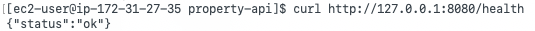
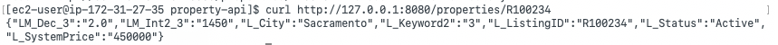
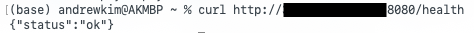
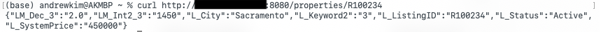
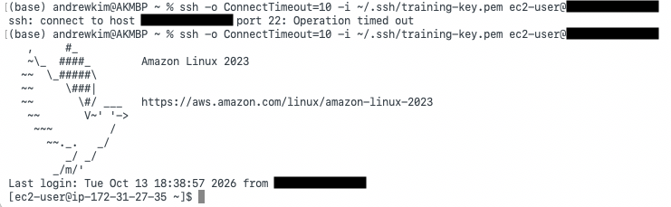
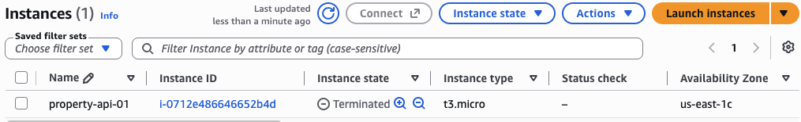

# Week 03 — Compute: EC2

## Lab 3.1 — Deploy PropertyLite to EC2

EC2, aka Elastic Compute Cloud, is a virtual server that AWS rents out. PropertyLite, which is the same Flask app from Week 0, was placed on an instance named `property-api-01`. The instance uses the Amazon Linux 2023 AMI and a `t3.micro`, which is the Free Tier size, so the cost stays inside the budget from Week 1. A key pair called `training-key` was saved at `~/.ssh/training-key.pem`. That `.pem` is the only copy AWS will give, which means losing the file also means losing SSH, necessitating that it stay somewhere permanent. The security group is the firewall on that one instance. It is stateful, which means an allowed request is allowed to send its reply back out. SSH on port 22 is limited to My IP, and TCP 8080 is open from anywhere, because PropertyLite listens on 8080. Due to the open nature of a public address, SSH has to stay on one IP, otherwise anyone on the internet could try to log in. A NACL, aka a network ACL, is the other filter. That one sits on the subnet and is stateless, which means the return traffic needs its own rule. This lab only needed the security group. User data is a script that runs once at launch, so the instance installs Python, writes `app.py` and the sample CSV into `/opt/property-api`, and starts Flask by itself. The files do not have to be copied over after SSH. Before connecting, the key is locked down with `chmod 400`. If the permissions are too open, SSH refuses the key. The address on the box only exists inside the VPC. The laptop reaches the instance at its public address.

```bash
#!/bin/bash
yum update -y
yum install -y python3 python3-pip
pip3 install flask==3.0.3
mkdir -p /opt/property-api
cat > /opt/property-api/app.py << 'PYEOF'
# Week 0 PropertyLite app.py
PYEOF
cat > /opt/property-api/rets_property_sample.csv << 'CSVEOF'
L_ListingID,L_City,L_Keyword2,LM_Dec_3,LM_Int2_3,L_SystemPrice,L_Status
R100234,Sacramento,3,2.0,1450,450000,Active
R100235,Fresno,4,2.5,1900,395000,Active
R100236,Sacramento,2,1.0,900,299000,Pending
CSVEOF
cd /opt/property-api && nohup python3 app.py > /var/log/property-api.log 2>&1 &
```

From inside the instance, `curl` against `127.0.0.1` shows Flask is running on the box. `/health` returns ok.



`/properties/R100234` returns the Sacramento listing, which is the same row from the sample CSV.



From the Mac, the same two calls go to the public IP on port 8080. This is the exact app that was tested locally, now running on real infrastructure. `/health` returns `{"status":"ok"}`.



The listing call returns Sacramento, 3 bedrooms, list price 450000, status Active.



## Lab 3.2 — EBS snapshot

The root disk of `property-api-01` is an EBS volume, aka Elastic Block Store. A snapshot is a backup of that volume at one moment in time. One was created from the root volume and left until the status said completed. A new volume made from that snapshot would be a copy of the disk as it was when the snapshot finished, which means the app files that user data wrote would already be on it. That volume could be attached to another instance and the files would still be there. This could be analogous to photocopying a filing cabinet. The copy has the same papers, even after the original cabinet is thrown out.

## Debug Lab 3.3 — SSH connection times out

The first SSH to the public address sat there and then returned `Operation timed out`. The instance was in the running state, so the problem was the path in.



My IP on a home connection can change between sessions. The security group rule for port 22 was set to My IP at creation, which means AWS saved that one address and does not look it up again later. Due to that, a new address is treated as a stranger, and the SSH never reaches the instance. The fix is to edit the inbound SSH rule and set the source to the current IP. After that, SSH landed on Amazon Linux 2023. This could be analogous to a bouncer holding last night's guest list. The name is still right, but the list itself is old, so the door stays shut until the new address is written down.

## Cleanup

An EC2 instance keeps costing money while it is running, which means it has to be terminated at the end of the lab. `property-api-01` was terminated.



The instance state is Terminated. It was a `t3.micro` in `us-east-1c`, id `i-0712e486646652b4d`. Terminating the instance also deletes the root volume, so the Volumes tab was checked and that disk was gone too. Lastly, leaving the instance up would be like leaving the office lights on after everyone has gone home. The work is finished, but the bill continues.
